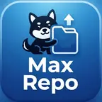

  

  

  
  
  

  <a href="#what-you-can-do">Features</a> ·
  <a href="#get-maxrepo">Download</a> ·
  <a href="#getting-started">Getting started</a> ·
  <a href="#security--privacy">Security</a> ·
  <a href="#about-the-developer">About me</a> ·
  <a href="#feedback">Feedback</a>

## Why I built MaxRepo

I wanted a way to work on my projects directly from my phone without constantly needing a computer. Not everyone has access to a powerful PC, and I believe that shouldn't stop someone from learning, creating, or developing software.

That's why I built **MaxRepo** — a mobile developer workspace that brings GitHub repository management, build monitoring, APK downloads and useful development tools together in one Android app.

My goal is simple: make mobile development more accessible and less frustrating.

## What you can do

| Workspace | Features |
| --- | --- |
| **Repositories** | Browse and manage GitHub projects, branches and files. |
| **Builds** | Monitor GitHub Actions, inspect logs and download build artifacts. |
| **Files** | Manage downloaded APKs and inspect their version, checksum and signing compatibility. |
| **Developer Studio** | Edit local source, preview UI designs, inspect project files, organize tasks and test API requests. |
| **Release tools** | Inspect APK packages, prepare workflow templates and generate encrypted signing keystores locally. |

Some operations depend on your GitHub permissions, network connection and project configuration. MaxRepo is not a replacement for every desktop IDE or build tool.

## Get MaxRepo

**Version 1.0.0 — first release in preparation.**

The signed release candidate has passed automated signing, build and package verification. I'm finishing the security review and real-device testing before making the official APK available.

[View releases](https://github.com/ermaclorenzo57-lgtm/GitHubManageApk/releases) · [Release notes](CHANGELOG.md)

**Requirements:** Android 10 or newer. GitHub features need an internet connection and a GitHub account. Local tools can be used without signing in.

## Getting started

1. After the official release, download the signed APK from this project's Releases page.
2. Install it using Android's package installer. Only allow installation from a trusted source.
3. Open MaxRepo and connect GitHub in Settings if you want to manage repositories.
4. Use a classic or fine-grained personal access token with only the permissions you need.
5. Open Repos, Builds, Files or Studio to begin.

For supported GitHub workflows, builds run on GitHub Actions rather than on your phone.

## A look inside MaxRepo

The app brings together five main areas: **Home · Repos · Builds · Files · Studio**. It includes light and dark themes and developer tools designed for touch screens.

I'm preparing clean screenshots using demo repositories so no account credentials or private project information are displayed.

## Security & privacy

I take the protection of developer accounts seriously. MaxRepo uses Android Keystore-backed token storage and HTTPS for GitHub communication. The APK signing tools create encrypted keystores locally. Never share a personal access token, signing password or private key.

Automated security and dependency checks are being established; the audit is still in progress. I won't claim that the app is completely secure simply because automated tests pass.

[Privacy notice (pre-release)](PRIVACY.md) · [Security reporting](SECURITY.md)

## Frequently asked questions

**Is MaxRepo an official GitHub app?** No. MaxRepo is an independent project, not affiliated with or endorsed by GitHub.

**Do I need a computer?** Not for the supported repository, Actions, artifact and local Studio workflows. Some projects still require their own build environment.

**Can I use private repositories?** Yes, when your token and organization settings allow the requested operation.

**How do updates work?** Official APKs are intended to use the same signing identity. Android may reject development builds signed with a different key.

## About the Developer

Hi! I'm an independent developer with a passion for software development, technology, and creating useful applications.

I started MaxRepo because I wanted to make development more accessible, especially for people who rely on their smartphones instead of computers.

I believe that limited resources shouldn't limit creativity. Through my projects, I hope to help aspiring developers turn their ideas into reality.

MaxRepo is one of my projects, and I'm continuously learning, experimenting, and improving it.

## Feedback

If MaxRepo helps you, a star on this repository is appreciated. If you find a bug or have a feature idea, I'd love to hear about it through [GitHub Issues](https://github.com/ermaclorenzo57-lgtm/GitHubManageApk/issues).

Please remove account details, private project data and credentials from any screenshots or logs before posting. Report security concerns privately as described in [SECURITY.md](SECURITY.md).

I'm building MaxRepo for developers who want to do more with the devices they already have.

---

<strong>MaxRepo — Build. Manage. Ship. Anywhere.</strong>

Independent Android project · <a href="docs/DEVELOPMENT.md">Development notes</a> · <a href="docs/RELEASE-CHECKLIST.md">Release readiness</a>

